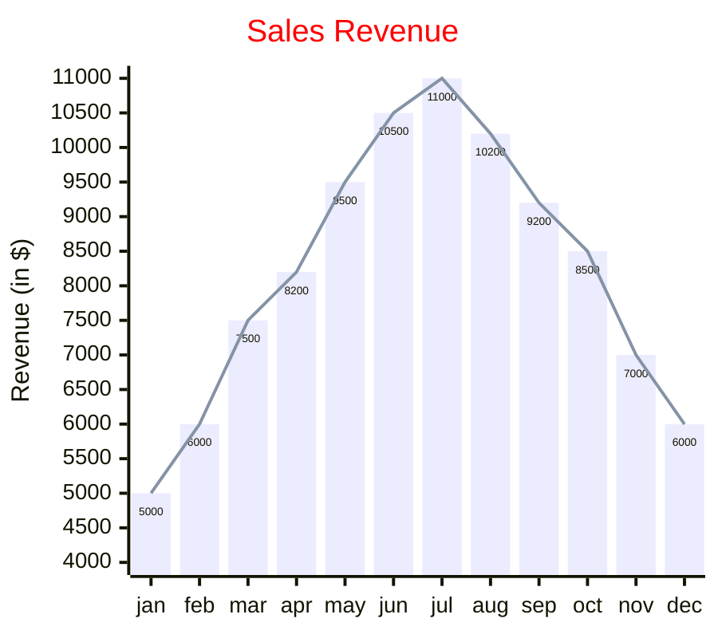

# Chapter 1: Introduction

This is the **first chapter** of our document. It contains:

- Important information
- Key concepts
- Essential details

## Section 1.1

Here's some code:

```javascript
function hello() {
  console.log('Hello, World!');
}
```

## Section 1.2

> This is a blockquote with some important information.

| Feature | Status |
|---------|-------:|
| PDF Export | ✓ |
| Cover Page | ✓ |
| Custom Styles | ✓ |


<div style="display: grid; grid-template-columns: 1fr 1fr; gap: 20px;">
<div>

## Column 1
Content for first column

| Feature | Status |
|---------|-------:|
| PDF Export | ✓ |
| Cover Page | ✓ |
| Custom Styles | ✓ |

</div>
<div>

## Column 2
Content for second column


</div>
</div>


