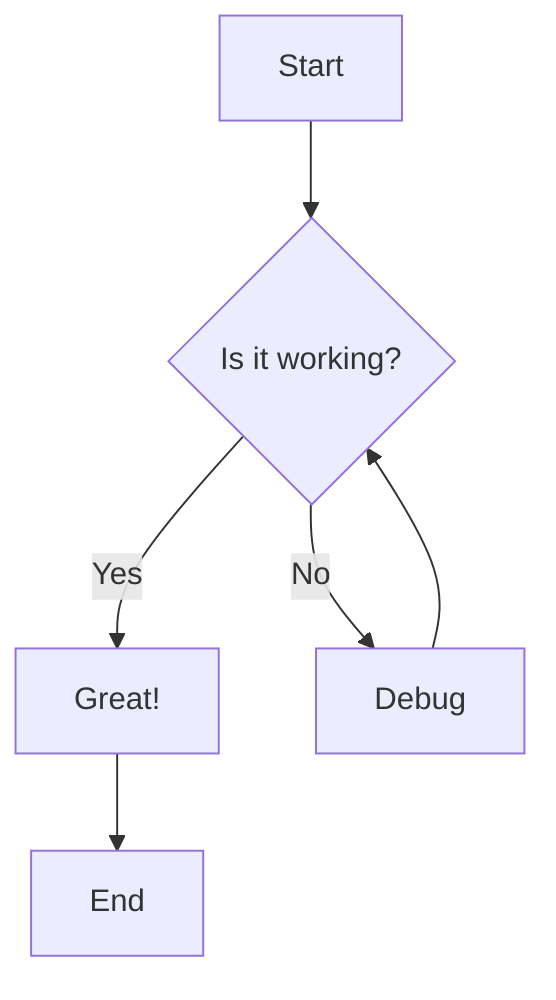
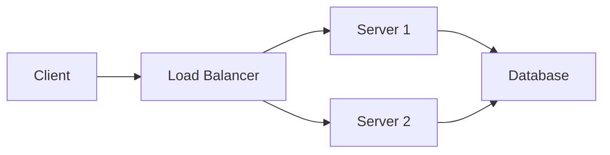

# Chapter 2: Advanced Topics

This is the **second chapter** with more details.

## Data Analysis

Some important findings:

1. First finding
2. Second finding
3. Third finding

### Process Flow

Here's a flowchart showing our process:

### System Architecture

### Subsection

More detailed information goes here.
