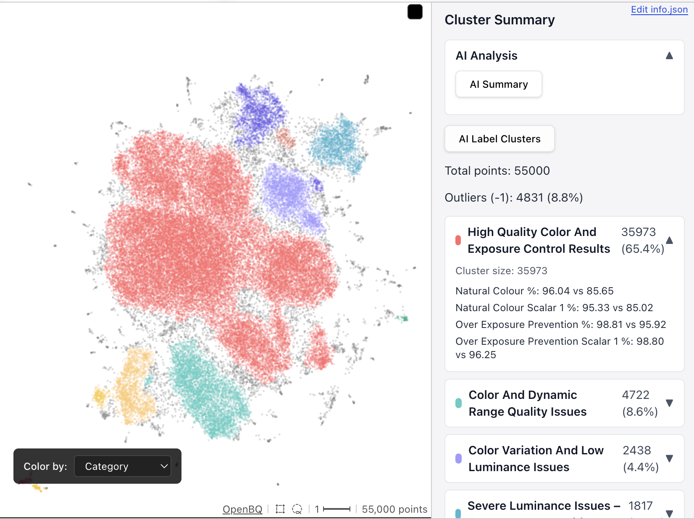
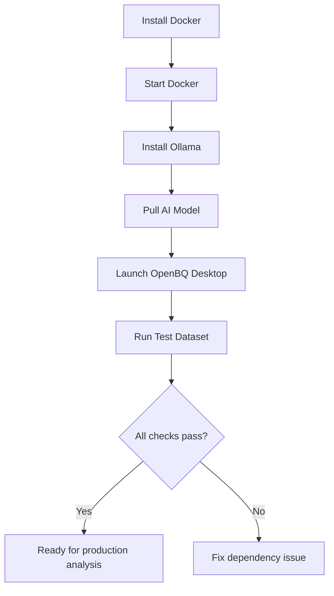
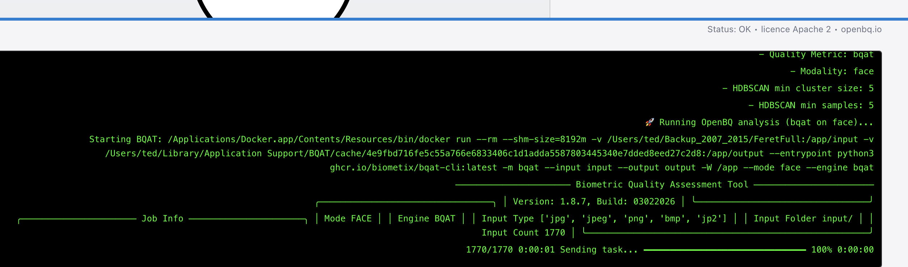

# Setup and First Run

This guide helps you get OpenBQ Desktop running for the first time, including required dependencies and what to expect during startup.

Even though setup is short, it is important. Most early user issues are not analysis problems, they are environment problems such as Docker not running or AI models not being available yet.

Taking a few extra minutes to confirm setup health before loading data will save significant time later and make your first analysis run much smoother.

> [!IMPORTANT]
> **Things to Think About**
> - Is this machine suitable for repeated analysis runs (CPU/RAM/disk)?
> - Are your dependency versions managed consistently across your team?
> - Who is responsible for maintaining Docker/Ollama in your environment?

Figure: Screenshot of openbq destop with a large dataset.

## Scenario Examples

### Scenario A: First-time installation on a laptop
You install OpenBQ Desktop on a laptop used for demonstrations.  
Before a live session, you should run one full test analysis so first-run downloads happen ahead of time.

### Scenario B: Shared team workstation
Multiple analysts use one workstation for biometric reviews.  
Agree on who maintains Docker and Ollama so analysis does not fail unexpectedly during handovers.

## Before You Start

OpenBQ Desktop depends on two key tools:

- **Docker**: runs analysis services used by OpenBQ Desktop.
- **Ollama**: provides local AI models for AI-assisted explanations and summaries.

Without Docker, core analysis will not run.  
Without Ollama (or another AI backend), AI features will be unavailable.

## Step-by-Step Setup

1. Install Docker Desktop for your platform.
2. Start Docker Desktop and confirm it is running.
3. Install Ollama from [https://ollama.com/download](https://ollama.com/download).
4. Start Ollama.
5. Pull at least one Ollama model (for example, `gpt-oss:20b`).
6. Launch OpenBQ Desktop.

## First Run: What Is Happening

The first time you run OpenBQ Desktop analysis, the app may need to:

- Pull or build Docker images used for UMAP/clustering or related processing.
- Download or initialize model files for AI-assisted features.
- Initialize local caches.

This can take several minutes. Slow startup on first run is expected.

## How to Tell Setup Is Healthy

Inside OpenBQ Desktop:

- The footer/status area should indicate Docker is installed and running.
- AI settings should allow you to configure or select a backend.
- Opening a dataset should start processing (instead of immediately failing dependency checks).

## Common First-Run Issues

### Docker is installed but not running

Symptoms:
- “Docker is not running” warning.
- Analysis does not start.

Fix:
- Open Docker Desktop and wait until it shows “running.”
- Restart OpenBQ Desktop if needed.

### Ollama is installed but no model is available

Symptoms:
- AI actions fail or return empty/error responses.

Fix:
- Pull a model in Ollama first.
- In OpenBQ Desktop Settings, make sure the model name exactly matches the pulled tag.

### First run seems stuck

Symptoms:
- Very slow initial processing with little visible result.

Fix:
- Check internet access and Docker/Ollama status.
- Wait longer on first run.
- Review bottom log/status messages for progress hints.

