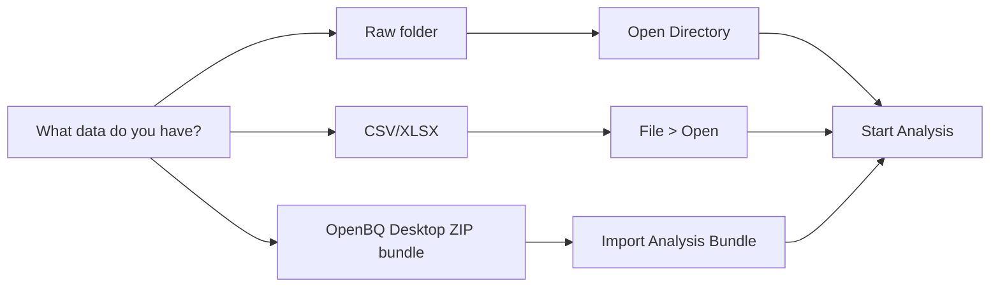
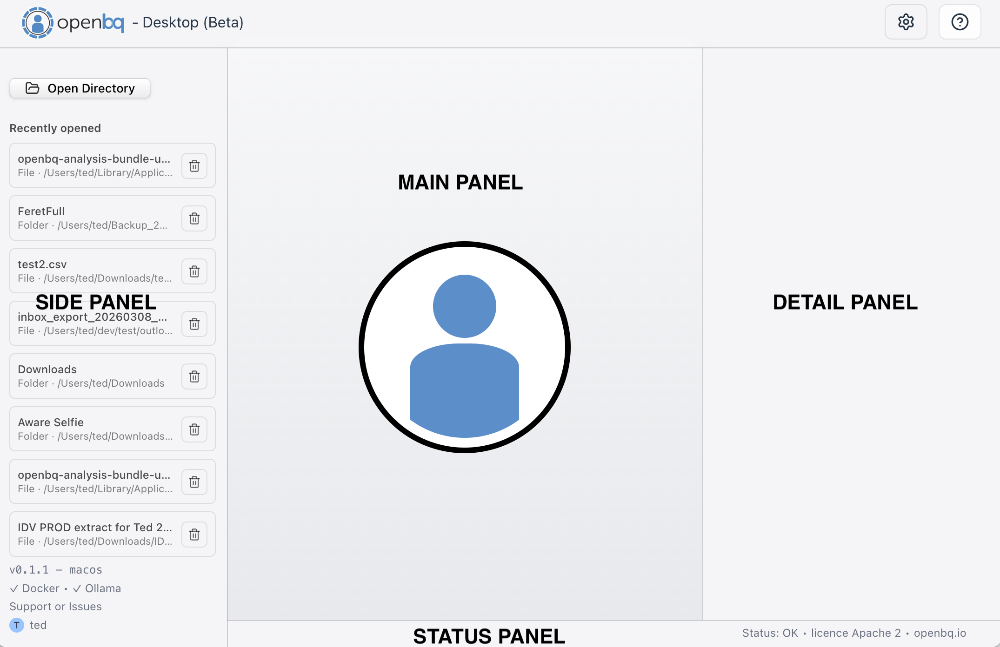

# Interface Tour and Data Loading

This section explains what each major part of OpenBQ Desktop is for and how those parts fit together during real analysis work.

Many users jump straight into loading data and miss how the interface is designed to support a workflow: status first, visual exploration second, and evidence review third. Understanding this flow makes the tool feel much simpler.

You will also learn when to use each loading path (directory, tabular file, or bundle archive) so your data enters OpenBQ Desktop in the most efficient and reliable way.

> [!TIP]
> **Things to Think About**
> - Which loading method best matches your current data source?
> - Do you need reproducibility (bundle import/export) or quick exploration?
> - What signals in the status/log areas tell you a run is healthy?

## Scenario Examples

### Scenario A: You received a folder from operations
Operations sends a raw biometric capture folder.  
Use **Open Directory** so OpenBQ Desktop can process directly from source files.

### Scenario B: You received a CSV from another analyst
Another analyst already exported rows to CSV/XLSX.  
Use **File > Open** for the fastest path into visual analysis.

### Scenario C: You need to continue someone else's work
You are asked to continue a previous investigation exactly where it left off.  
Use **Import Analysis Bundle** to restore rows and metadata context.

## Interface Tour

OpenBQ Desktop is organized into four practical work areas:

## Side Panel

What it is:
- The status and onboarding area shown before or during processing.

What it is for:
- Showing startup/processing state.
- Displaying errors or warnings.
- Offering cancel controls when processing is active.

When you use it:
- At app start.
- While data is being loaded/analyzed.
- When troubleshooting failed runs.

## Main Panel

What it is:
- The central visualization workspace.

What it is for:
- Viewing UMAP points (the 2D data map).
- Exploring structure, spread, clusters, and outliers.
- Selecting points or groups for deeper review.

When you use it:
- During active analysis.
- Any time you need to visually compare patterns.

## Detail Panel

What it is:
- The right-side inspection panel for selected data.

What it is for:
- Viewing quality attributes for selected records.
- Seeing cluster summary metrics.
- Running AI actions such as “AI Summary” and “AI Label Clusters.”

When you use it:
- After selecting an individual record or a group.
- When turning visual observations into concrete findings.

## Status Panel

What it is:
- The bottom log/status area (sometimes casually called the “statis” panel).

What it is for:
- Showing processing logs and run progress.
- Helping you diagnose slow or failed runs.

When you use it:
- During long analysis runs.
- During setup/troubleshooting.

## Data Loading Methods

OpenBQ Desktop supports three common ways to start analysis.

## 1) Load from a biometric directory

Best for:
- Raw capture folders and operational data drops.

Steps:
1. Click **Open Directory**.
2. Select the folder containing biometric files.
3. Choose modality/analysis options.
4. Start analysis.

Why use this:
- Natural workflow when data is organized in folders.
- Good for end-to-end processing from source files.

## 2) Load from CSV/XLSX

Best for:
- Prepared datasets, exported reports, and tabular quality records.

Steps:
1. Use **File > Open**.
2. Select `.csv` or `.xlsx`.
3. OpenBQ Desktop parses rows and begins the analysis workflow.

Why use this:
- Fastest path when data is already tabular.
- Useful for repeat analysis and shared analyst workflows.

## 3) Load from an archive (Analysis Bundle ZIP)

Best for:
- Sharing complete analysis context between machines/users.
- Restoring prior work with metadata/cache context.

Steps:
1. Use **Import Analysis Bundle**.
2. Select a previously exported OpenBQ Desktop ZIP bundle.
3. OpenBQ Desktop restores rows and associated metadata.

Why use this:
- Improves reproducibility and collaboration.
- Reduces rework when analysis context must be preserved.

## Caching: What It Means for Daily Use

OpenBQ Desktop uses caching to speed up repeat analysis.

## UMAP cache

Purpose:
- Reuse previously computed embeddings when inputs/settings match.

Benefit:
- Faster reruns, especially during parameter tuning.

## Analysis/cluster cache metadata

Purpose:
- Preserve processed context tied to dataset and settings.

Benefit:
- Less repeated compute and quicker return to prior states.

## When to clear cache

Use **Settings > Clear Analysis Cache** when:
- Results appear stale.
- You changed data content significantly.
- You are validating whether a parameter change truly changes output.
