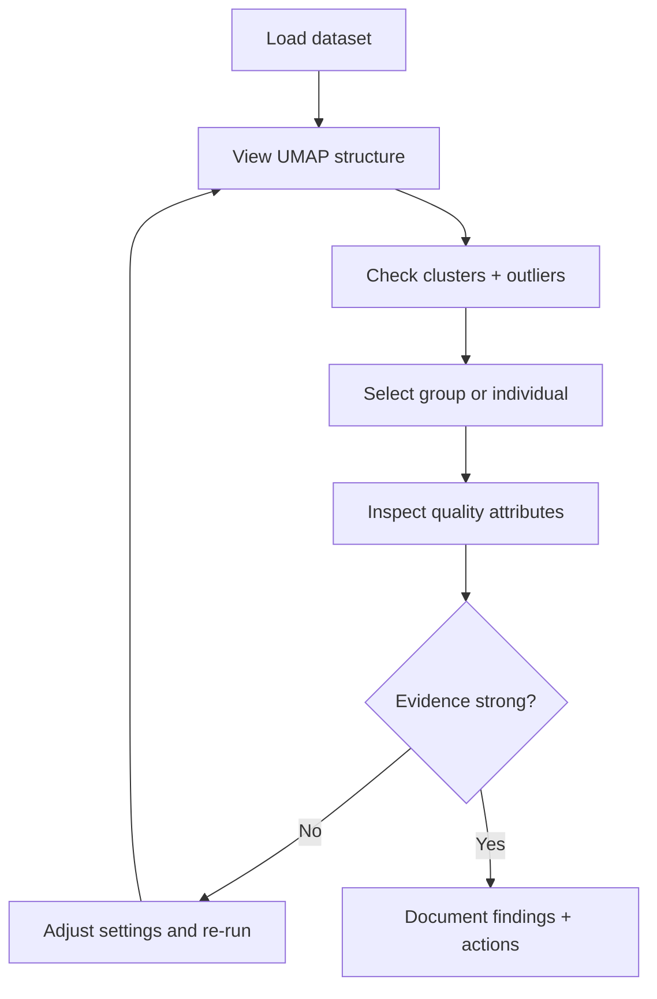
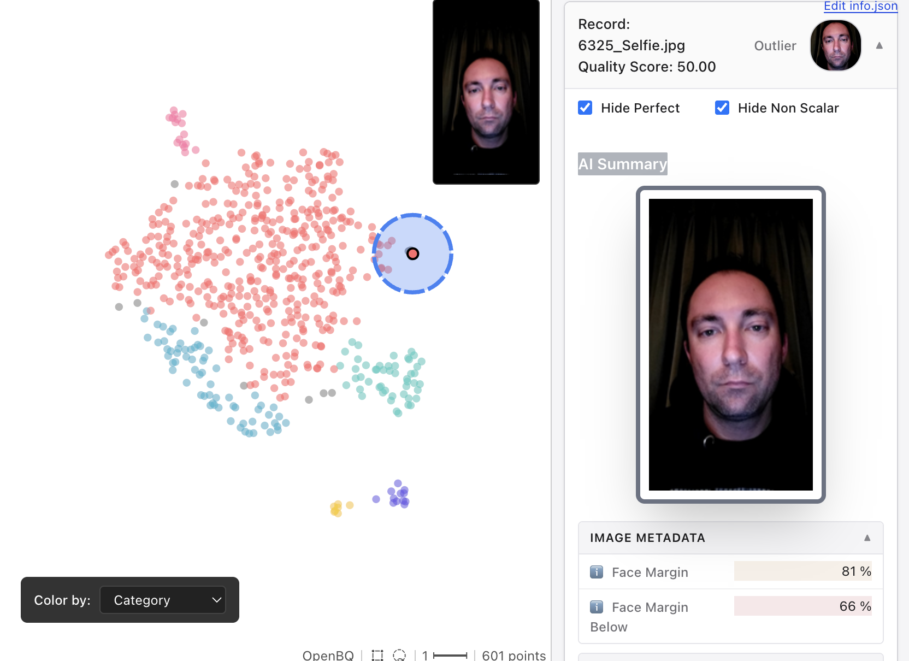

# Analysis Workflow

This section explains how to interpret UMAP and clustering outputs in practical terms and how to turn those outputs into evidence-based decisions.

The goal is not just to "get clusters." The goal is to identify reliable patterns, understand outliers, and connect findings to quality improvement actions your team can actually take.

This chapter is written to help you move from a broad visual overview into specific sample-level diagnostics without losing context along the way.

> [!TIP]
> **Things to Think About**
> - What makes a pattern meaningful in your operational context?
> - Could an apparent cluster be caused by metadata or preprocessing artifacts?
> - What evidence would you need before recommending process changes?

## Scenario Examples

### Scenario A: Spike in verification failures
Your team reports increased verification failures over the last week.  
Use UMAP + clustering to check whether a new low-quality subgroup has emerged (for example lighting, capture angle, or device-specific behavior).

### Scenario B: Quality audit before rollout
A new enrollment workflow is about to launch.  
Use OpenBQ Desktop to compare quality structure and outlier rates before rollout so risks are identified early.

### Scenario C: Investigating outliers
You notice a small outlier group in the embedding.  
Drill into Detail Panel records and confirm whether outliers are true quality issues or data/mapping artifacts.

## What UMAP Is (in plain language)

UMAP takes many quality attributes per sample and maps them into 2D so similar records appear closer together.

Important reminder:
- UMAP axes are not direct quality scores.
- Distances/patterns are what matter most.

Use UMAP to answer:
- Are there natural groups in this dataset?
- Are there unusual outliers?
- Does the data look consistent or fragmented?

## What a “good” UMAP usually looks like

Healthy signals:
- Clear but not forced structure.
- Cohesive groups with understandable differences.
- Outliers that are limited and explainable.

Caution signals:
- One chaotic cloud with no separable structure.
- Too many tiny fragments (possible over-tuning).
- Patterns driven by non-quality fields rather than actual quality behavior.

## Understanding Clustering

Clustering helps turn visual groupings into measurable segments.

OpenBQ Desktop provides multiple clustering approaches:
- **UMAP HDBSCAN**: robust density clustering over 2D embedding.
- **UMAP JS DBSCAN**: fallback/alternative DBSCAN behavior.
- **PCA HDBSCAN**: cluster in reduced high-dimensional space before/without relying only on 2D view.
- **Supercluster**: spatial grouping behavior useful for certain visualization-focused workflows.

Practical approach:
1. Start with defaults.
2. Inspect cluster summary and outlier rates.
3. Adjust settings only if the current segmentation is not useful.
4. Re-compare against domain expectations.

## Cluster Settings: What They Do

- **Cluster Sensitivity**:
  Fine = more clusters, Coarse = fewer clusters.
- **Min Points / Min Samples**:
  Controls how much local evidence is needed to form a cluster.
- **UMAP Neighbors / Min Dist**:
  Changes local/global balance and compactness of embedding.
- **Exclude Non Scalar / One-hot Encode / Exclude Low Variance**:
  Controls how fields are prepared for analysis and can strongly affect clustering quality.

Rule of thumb:
- Change one setting family at a time and re-check outcomes.

## Selecting an Individual and Reviewing Quality Attributes

1. Click a point in the Main Panel (or make a focused selection).
2. In Detail Panel, inspect the selected record’s quality fields.
3. Review associated histograms and formatted attributes.
4. Use **AI Summary** for a plain-language interpretation if needed.

Why this matters:
- Group patterns are useful, but remediation happens at sample/process level.

## Selecting a Group and Reviewing Group Information

1. Select a region/cluster in Main Panel.
2. In Detail Panel, review cluster-level counts and differences.
3. Check outlier count and proportion.
4. Use **AI Summary** for a concise group narrative.

Why this matters:
- Group-level diagnostics help identify systemic issues (capture environment, process drift, modality-specific behavior).

## Practical Validation Checklist

Before finalizing conclusions, verify:
- Cluster differences are meaningful in real quality fields.
- Outliers are not just parsing or metadata artifacts.
- Re-running with nearby settings does not completely invalidate conclusions.
- Findings align with operational context (sensor, workflow, environment).
