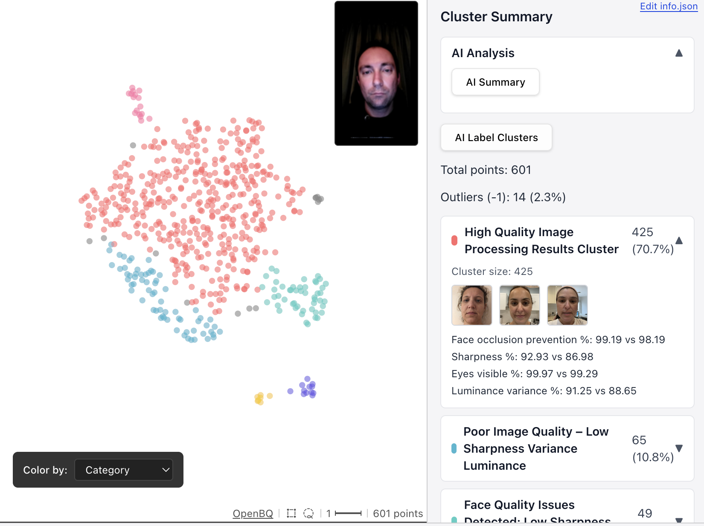
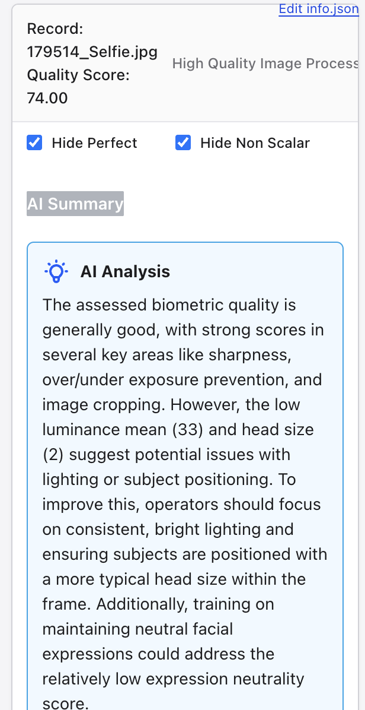

# Using AI Assistance

This section explains how to configure AI in OpenBQ Desktop and how to use it safely for cluster, individual, and report-style analysis.

AI features are most useful when they help you communicate findings faster and more clearly. They are less useful when treated as an unquestioned source of truth.

Think of AI as a quality analyst assistant: fast at summarizing and labeling, but still dependent on your judgment, your data quality, and your verification discipline.

> [!WARNING]
> **Things to Think About**
> - Are you using AI output as a draft or as a final conclusion?
> - What verification step will you use before sharing AI-generated findings?
> - Does your organization require local AI only, or allow external providers?

## Scenario Examples

### Scenario A: Executive briefing in one hour
You need a concise summary of major quality findings quickly.  
Use AI cluster summary to draft a narrative, then validate key statements against actual cluster metrics.

### Scenario B: Training a junior analyst
A junior analyst is unsure how to interpret a complex sample.  
Use AI individual summary as a teaching aid, then compare AI wording to the real underlying attributes.

### Scenario C: Naming clusters for a stakeholder deck
Cluster IDs are hard for non-technical audiences.  
Use **AI Label Clusters** to create plain-language labels, but keep numeric IDs available for traceability.

## What AI Features Are For

AI in OpenBQ Desktop is designed to:
- Translate technical quality metrics into plain-language explanations.
- Label clusters with short, human-readable descriptions.
- Speed up triage and report drafting.

AI is an assistant, not a replacement for analyst judgment.

## AI Settings

Open **Settings** and configure:

- Backend: `ollama`, `openai`, `claude` (and `apple` on macOS where available)
- Model name
- Temperature (creativity vs consistency)
- Max tokens (response length limit)
- Optional focus instructions (named prompt guidance sets)

## Recommended Setup for Non-Experts

If your organization prefers local processing:
1. Select **Local AI (Ollama)**.
2. Set Ollama URL (usually `http://localhost:11434`).
3. Select an installed model.
4. Keep temperature moderate for stable summaries.

If external provider use is allowed:
- OpenAI/Claude can be configured in Settings for cloud responses.

## AI Cluster Analysis (Cluster Labels)

Feature:
- **AI Label Clusters** in the Detail Panel.

What it does:
- Reviews key differences per cluster.
- Produces short labels that are easier to present to stakeholders.

Best use:
- Naming clusters in a meaningful, consistent way for communication.

## AI Individual Analysis

Feature:
- **AI Summary** for selected items/records.

What it does:
- Explains quality attributes and likely issues for one sample.
- Helps analysts quickly understand problematic captures.

Best use:
- Triage, training, and case-by-case review.

## AI Report Summary

Feature:
- Cluster-level **AI Summary** in Detail Panel.

What it does:
- Produces structured narrative sections, including:
- overall quality summary
- cluster findings
- outlier observations
- recommendations

Best use:
- Drafting internal reports or briefing notes.

## Good AI Practice

Use AI responsibly:
- Treat AI output as draft analysis, not final truth.
- Validate claims against actual metrics and charts.
- Watch for overconfident statements when data quality is weak.
- Keep focus instructions clear and specific for consistent output style.

## Troubleshooting AI Responses

### “Error generating AI summary”

Check:
- Backend selected correctly.
- Backend is reachable (for example Ollama running).
- Model name matches an installed model.
- API key present if using external providers.

### AI output is too generic

Improve by:
- Lowering temperature.
- Adding focus instructions (for example: “prioritize biometric quality drivers and operational actions”).
- Selecting more precise data subsets before asking for summary.
