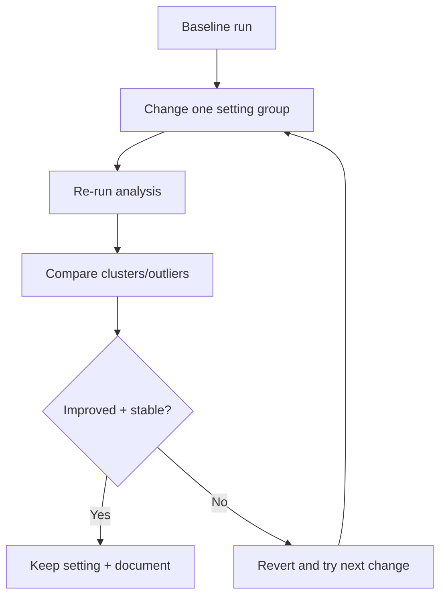

# Advanced Customization

This guide covers advanced controls for users who need finer control over clustering behavior, feature preparation, and metadata-driven display.

Advanced settings are powerful because they can improve cluster quality and interpretability, but they can also unintentionally introduce instability if changed too aggressively.

Use this section when you are ready to tune analysis deliberately, test changes methodically, and document what works for your dataset profile.

> [!NOTE]
> **Things to Think About**
> - Which parameters are you changing, and why?
> - How will you compare "before" and "after" in a fair way?
> - Are your tuning choices reproducible by another analyst on your team?

## Scenario Examples

### Scenario A: Too many tiny clusters
Your current run produces many micro-clusters that are hard to interpret.  
Try a coarser sensitivity preset, then increase strictness controls to reduce fragmentation.

### Scenario B: One large unhelpful cluster
Your data collapses into one dominant group with little insight.  
Try finer sensitivity and review feature toggles (non-scalar exclusion, one-hot encoding, low-variance exclusion).

### Scenario C: Standardizing an internal SOP
Your team wants repeatable outcomes across analysts.  
Define baseline settings, test on reference datasets, and save/export bundles for controlled reuse.

## When to Use Advanced Settings

Use advanced settings when:
- Default clustering is too coarse or too fragmented.
- You need reproducible tuning for a specific dataset type.
- You are building repeatable analyst workflows.

If you are new to OpenBQ Desktop, start with defaults first.

## Cluster Method Selection

Open **Cluster Settings** and choose method:

- **UMAP HDBSCAN (2D)**:
  Good default for density-based groups in embedding space.
- **UMAP JS DBSCAN (frontend)**:
  Useful fallback and comparison mode.
- **PCA HDBSCAN (75% variance)**:
  Useful when structure is clearer in high-dimensional reductions.
- **Supercluster (UMAP)**:
  Spatial grouping behavior across UMAP points.

## Sensitivity Presets

Presets provide quick behavior changes:

- **Fine**: more, smaller clusters.
- **Balanced**: default compromise.
- **Coarse**: fewer, larger clusters.
- **Custom**: manual tuning.

Use presets first, then adjust specific parameters if needed.

## Core Tuning Controls

- **Min Points (minPts)**:
  Minimum points needed for a cluster candidate.
- **Min Samples**:
  Density strictness. Higher values are more conservative.
- **UMAP Neighbors**:
  Local vs global structure balance in embedding.
- **UMAP Min Dist**:
  Visual compactness/separation in embedding.

Practical advice:
- Raise strictness to reduce noisy micro-clusters.
- Lower strictness to detect finer sub-structure.

## Feature Engineering Toggles

- **Exclude Non Scalar**:
  Removes non-numeric fields from analysis input.
- **One-hot Encode Categories**:
  Converts categorical fields into model-usable numeric indicators.
- **Exclude Low Variance**:
  Removes features that add little differentiation.

These toggles can change clustering outcomes significantly.

## Metadata and Profile Configuration (`info.json`)

OpenBQ Desktop can use dataset-side metadata (for example `info.json`) to control:
- Field configuration/display behavior.
- Profile settings that influence how quality attributes appear.

Use this when:
- You need consistent interpretation across teams.
- You want predictable field naming and display behavior.

## Cache Management for Controlled Experiments

Use **Clear Analysis Cache** before controlled A/B tuning when you need clean reruns.

Recommended workflow:
1. Pick one dataset.
2. Record baseline settings.
3. Change one setting group at a time.
4. Compare cluster summary and outlier changes.
5. Save/export bundle when satisfied.

## Export/Import for Repeatability

Use analysis bundles to:
- Share results and context with others.
- Restore analysis state later.
- Improve reproducibility between environments.

This is strongly recommended for team-based quality reviews.
